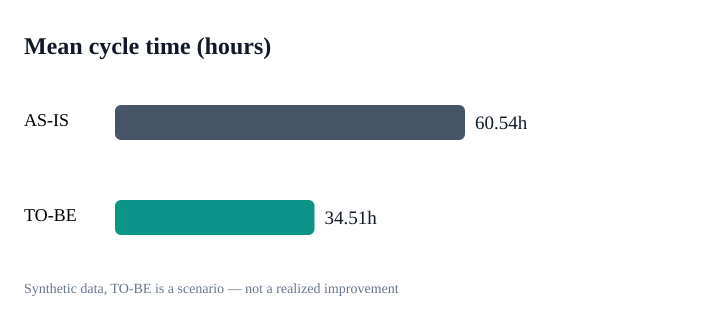
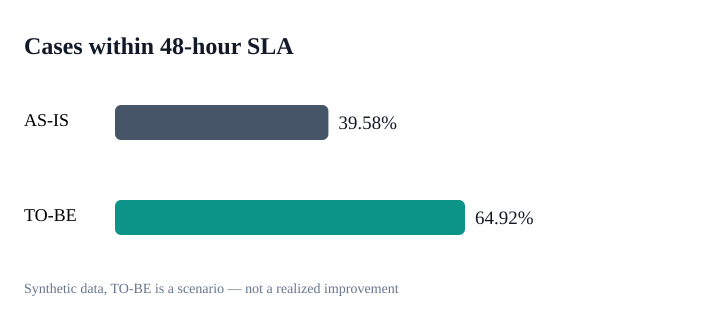

# Returns Process Optimization | Business Analysis Case

**Business analysis portfolio project** — AS-IS/TO-BE workflows, requirements, acceptance criteria, backlog, SQL and Python KPI model. **All data are synthetic; TO-BE is a simulated scenario, not a deployed change.**

## Business question
How could a marketplace shorten return-processing time without compromising refund controls, customer experience or auditability?

## Modeled results
- **1,200** synthetic return cases, with standard and exception routes.
- Mean cycle time: **60.54 → 34.51 hours** (scenario: **−43.0%**).
- 48-hour SLA: **39.58% → 64.92%**.
- Modeled handling capacity: **245.93 hours** saved; not a measured cash saving.




## Deliverables
- [AS-IS process map](diagrams/as_is.md) and [TO-BE process map](diagrams/to_be.md) (Mermaid in GitHub).
- [Functional/non-functional requirements and acceptance criteria](docs/requirements.md).
- [Prioritized backlog and pilot strategy](docs/backlog.md).
- [Assumptions and limitations](docs/assumptions.md).
- [Business findings](reports/findings.md) and [machine-readable summary](reports/summary.json).
- [SQL](sql/process_kpis.sql), [Python analysis](src/analysis.py), [tests](tests/test_analysis.py).

## Run locally (Python 3.10+)
From the repository root:
```bash
python -m src.analysis
python -m unittest discover -s tests -v
```
No third-party Python packages needed.

## Definitions and methodology
- **Cycle time:** sum of four elapsed stage durations.
- **SLA compliance:** share of cases whose cycle time is no more than 48 hours.
- **p90:** nearest-rank percentile.
- **Handling capacity saving:** modeled difference in labor handling minutes; converts to RUB using an assumed loaded cost (900 RUB/hour).
- **Not an ROI estimate:** excludes integration cost, fixed costs, refund errors, fraud and causal validation.

## What a real pilot would need
Real event data, a reviewed automation policy, operational risk controls and a controlled pilot with guardrails (wrongful refunds, duplicates, complaints, fraud). Results should be measured rather than assumed.
